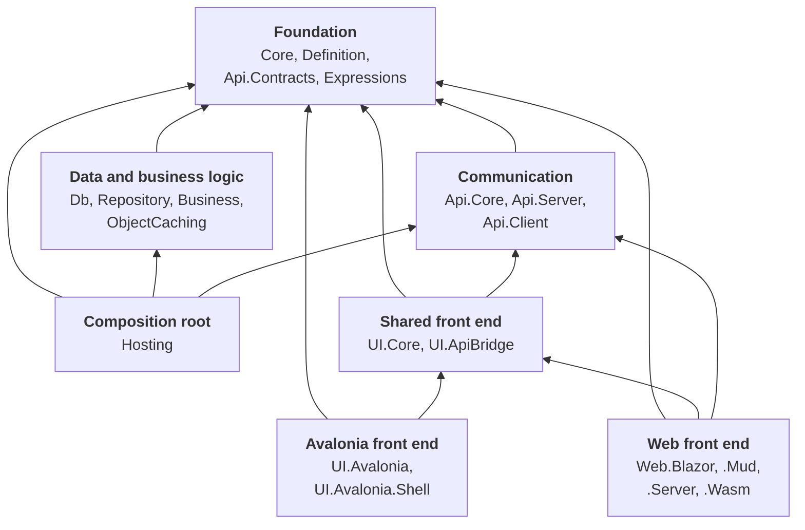
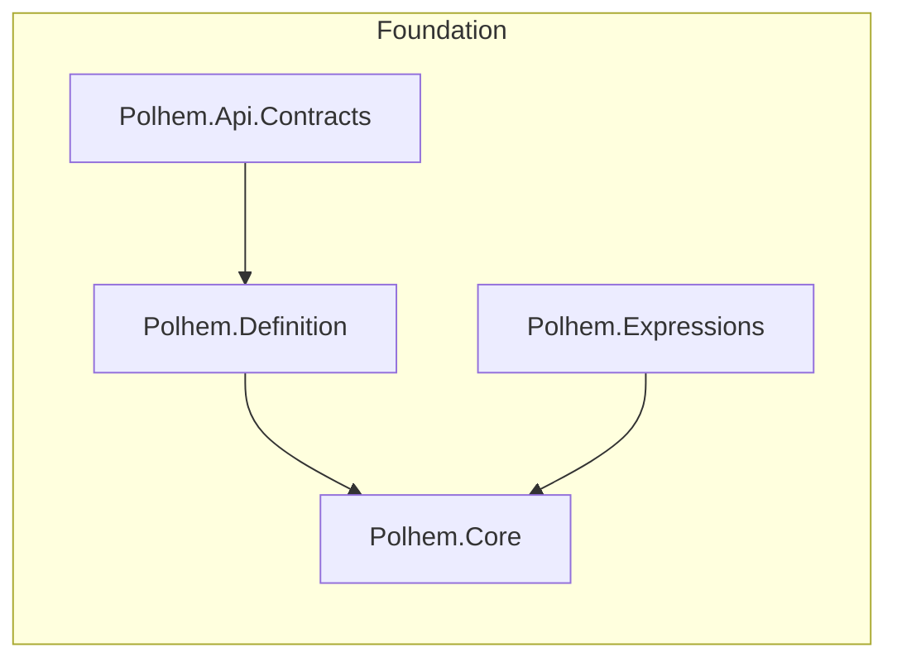
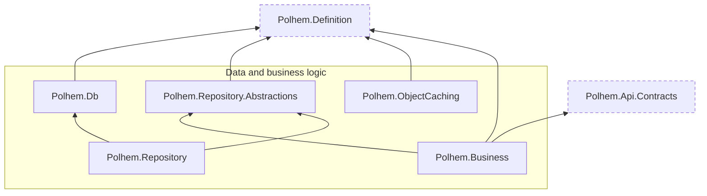
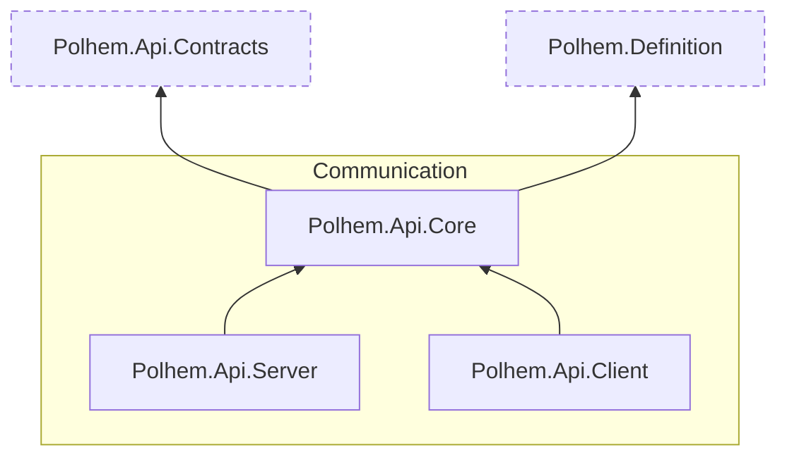
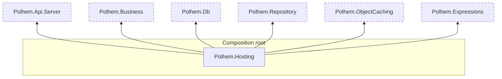
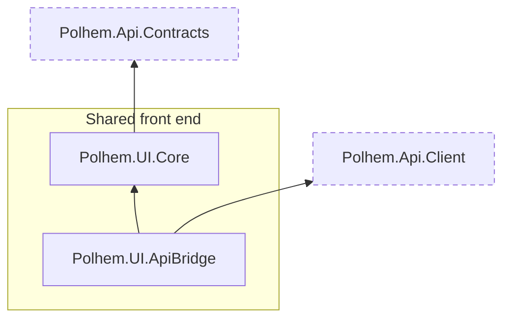
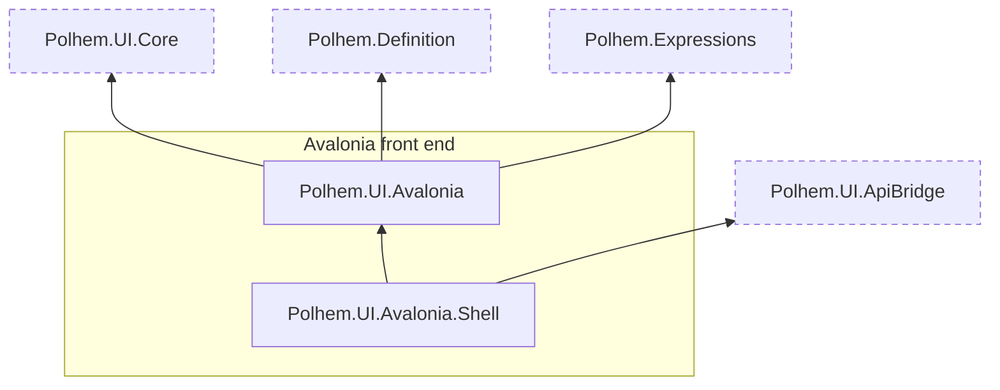
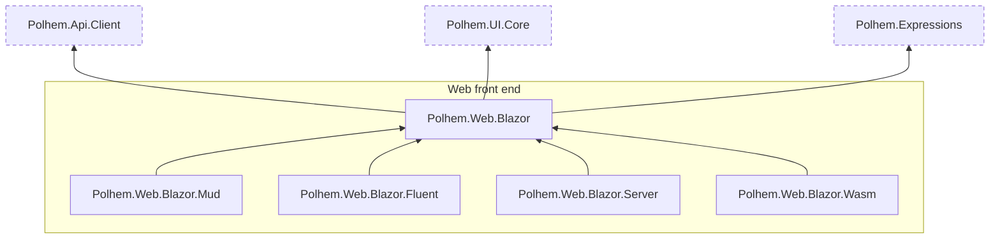

# Project Dependency Map

[繁體中文](../../zh-TW/architecture/dependency-map.md) · [← Docs Index](../README.md)

This document visualizes the dependencies among the `src/` projects of the Polhem framework.
The diagram covers the runtime packages; `Polhem.Analyzers` is left out because nothing references it
at runtime — consumers get it as a build-time analyzer, and drawing it would add an edge that does
not exist in the assembly graph. (No project count here: it drifts, and the `src/` directory is the
authority.)

**How to read**: an arrow A → B means "A depends on B"; the diagrams are laid out bottom-up, with the most foundational packages (no dependencies) at the bottom.

## Overview

Each box is an area, and its name lists the projects with `Polhem.` left out.

<!-- dependency-map:overview:start -->

<!-- dependency-map:overview:end -->

- The front ends and the back end meet only in **Foundation** and **Communication**.
- **Polhem.Hosting** assembles the back end.
- Both front ends stand on **Shared front end**.

## Projects by area

One diagram per area. A solid box belongs to the area, and a dashed box is a project of another area that it depends on. Together these diagrams are every project reference in `src/`. `./check-dependency-map.sh` compares them, and the overview, with the csproj files on every push.

<!-- dependency-map:areas:start -->
### Foundation

Both the front end and the back end stand on these. `Polhem.Core` is the bottom of the graph.

### Data and business logic

Server-side only. `Polhem.Business` reaches data through `Polhem.Repository.Abstractions`, never through `Polhem.Db`.

### Communication

The wire layer and its two ends. `Polhem.Api.Client` never reaches `Polhem.Api.Server`: they share only `Polhem.Api.Core`.

### Composition root

`Polhem.Hosting` puts the back end together, so it references the server-side projects directly.

### Shared front end

`Polhem.UI.Core` carries no transport. `Polhem.UI.ApiBridge` joins it to the client for the Avalonia front end.

### Avalonia front end

`Polhem.UI.Avalonia` holds the controls and has no transport. `Polhem.UI.Avalonia.Shell` adds the ready-made application around them.

### Web front end

The shared layer, one package per UI framework, and one package per host. A UI package and a host package do not reference each other.

<!-- dependency-map:areas:end -->

## External Package Dependencies

| Project | External Packages |
|---------|-------------------|
| Polhem.Core | *(none)* |
| Polhem.Expressions | DynamicExpresso.Core 2.x |
| Polhem.Definition | Microsoft.Extensions.Localization.Abstractions 10.x |
| Polhem.Db | *(none)* |
| Polhem.ObjectCaching | Microsoft.Extensions.Caching.Memory 10.x, Microsoft.Extensions.Logging.Abstractions 10.x |
| Polhem.Api.Core | MessagePack 3.x, Polhem.JsonRpc.Payload |
| Polhem.Api.Server | Microsoft.Extensions.Logging.Abstractions 10.x, Polhem.JsonRpc.Server, Polhem.JsonRpc.Payload.Server |
| Polhem.Business | Microsoft.Extensions.DependencyInjection.Abstractions 10.x, Microsoft.Extensions.Logging.Abstractions 10.x |
| Polhem.Repository | Microsoft.Extensions.DependencyInjection.Abstractions 10.x |
| Polhem.Hosting | Microsoft.Extensions.DependencyInjection.Abstractions 10.x, Microsoft.Extensions.Hosting.Abstractions 10.x |
| Polhem.Web.Blazor | Microsoft.AspNetCore.Components.Web 10.x |
| Polhem.Web.Blazor.Server | `FrameworkReference: Microsoft.AspNetCore.App` |
| Polhem.UI.Avalonia | Avalonia 12.x, Avalonia.Controls.DataGrid 12.x |
| Polhem.Api.Client | Polhem.JsonRpc.Payload.Client |
| Polhem.UI.ApiBridge | Microsoft.Extensions.DependencyInjection.Abstractions 10.x |
| Polhem.UI.Avalonia.Shell | Avalonia 12.x, Avalonia.Controls.DataGrid 12.x, Semi.Avalonia 12.x, Semi.Avalonia.DataGrid 12.x, CommunityToolkit.Mvvm 8.x, Microsoft.Extensions.DependencyInjection 10.x |
| Polhem.Api.Contracts / Polhem.Repository.Abstractions / Polhem.UI.Core | *(none)* |

> `Polhem.Api.Core`'s MessagePack reference is the only transport-format package in the framework, and
> keeping it the only one is the point of [ADR-036](../../../maintainers/adr/adr-036-wire-serialization-externalized.md).
> The `Polhem.JsonRpc.*` packages are maintained in
> [polhem-dev/polhem-jsonrpc](https://github.com/polhem-dev/polhem-jsonrpc); the version the framework uses is set in
> `PolhemJsonRpc.props` at the repository root. An HTTP host adds `Polhem.JsonRpc.AspNetCore` itself.
> Build-time-only references (`PrivateAssets="all"`: SourceLink, the public API analyzers, the
> repository's own analyzers) are omitted — they reach no consumer.

## Target Framework Summary

All runtime packages target `net10.0`. The exception is `Polhem.Analyzers`, which targets
`netstandard2.0` — that is what Roslyn loads analyzers as, so it is a requirement of the analyzer
host rather than a choice.

## Tooling Packages (separately distributed)

Not part of the `src/` library graph above — these ship as `dotnet tool` global tools on NuGet:

| Package | Command | Description |
|---------|---------|-------------|
| **Polhem.Cli** (`tools/Polhem.Cli/`) | `dotnet polhem` | Framework CLI; `dotnet polhem --help` lists its commands. References `Polhem.Definition`, whose public `Defaults` API it calls for materialise / list operations on embedded framework defaults. Versioned with the framework (both read `Version.props`). |
| **Polhem.DefineEditor** (`tools/DefineEditor/`) | `polhem-define` | Avalonia desktop tool for visually editing the define types; also built as a macOS `.app`. Carries no database driver: it runs Polhem.DbManager for database work. |
| **Polhem.DbManager** (`tools/DbManager/`) | `polhem-db` | Runs the `db` commands of `Polhem.Hosting` against a definition folder, with the drivers of every supported database. |

## Architectural Notes

- **Polhem.Core** is the lowest-level foundation package with no internal dependencies.
- **Polhem.Expressions** holds `DynamicExpressoEvaluator`, the DynamicExpresso-backed implementation of the expression engine. The *abstraction* — `IExpressionEvaluator`, `ExpressionPolicy`, `ExpressionEvaluationException` — lives in `Polhem.Core.Expressions`, so `Polhem.Definition` (the `FormExpressionCalculator`) and `Polhem.Business` (the rule processor) consume the engine without taking a dependency on DynamicExpresso; only the composition roots that pick an implementation (`Polhem.Hosting` for DI registration, `Polhem.UI.Avalonia` and `Polhem.Web.Blazor.Server` for client-side live preview) reference this package; the live preview engine they share, `FormLiveComputationEngine` in `Polhem.UI.Core`, takes the evaluator from them. That split keeps the definition layer free of third-party packages while a field computed on the client still matches what the server writes on save. See [adr-028](../../../maintainers/adr/adr-028-expression-rule-engine.md) and [adr-038](../../../maintainers/adr/adr-038-definition-dependency-boundary.md).
- **Polhem.Definition** is the most depended-on project. Its direct dependents are Contracts, Db, RepoAbs, Caching, Business, Api.Core and UI.Avalonia.
- **Polhem.Api.Contracts** is a shared contract/abstraction layer, not an application-level API project. Despite the "API" name, both `Polhem.Business` and `Polhem.Api.Core` depend on it (`Business → Contracts`, `Core → Contracts`), so it sits *below* them — the diagram groups it under **Shared Contracts** rather than the API application layer.
- **Polhem.Hosting** is the composition root: it consolidates the backend services (`Polhem.Api.Server`, `Polhem.Business`, `Polhem.Db`, `Polhem.Repository`, `Polhem.ObjectCaching`) behind a single `AddPolhemFramework` extension on `IServiceCollection`, with no ASP.NET Core dependency. Non-web hosts (WinForms, Console, Worker Service) reference it directly. It is shown in its own **Composition Root** group rather than under API: reaching across every layer is what a composition root does, so the "API layer must not reference the Repository layer" constraint does not apply to it. What *does* apply is that it holds no data access of its own — statements live in `Polhem.Db` / `Polhem.Repository`, and Hosting keeps only the hosted-service shells and DI wiring.
- **The JSON-RPC protocol** comes from the `Polhem.JsonRpc.*` packages, which know nothing about Polhem: `Polhem.Api.Server` builds on `Polhem.JsonRpc.Server`, `Polhem.Api.Client` on `Polhem.JsonRpc.Client` (through `Polhem.JsonRpc.Payload.Client`, whose `PayloadConnector` seals each call), and an ASP.NET Core host adds `Polhem.JsonRpc.AspNetCore` for the `POST /api` endpoint. The dependency only goes that way. See [ADR-049](../../../maintainers/adr/adr-049-jsonrpc-packages-in-1-2.md).
- **Polhem.Api.Core** is the wire layer both ends share: the request and response messages, the payload codecs, compression and encryption, and the error contract, so the client (`Polhem.Api.Client`) and the server serialize and encrypt the same way. It holds none of the server side, and `POLHEM9001` keeps it that way. **Polhem.Api.Server** holds the server side: the dispatcher setup, the access and payload filters, API key and authorization checks, and the exception mapping. An in-process client reaches the dispatcher through `IInProcessTransportFactory`, which `AddPolhemFramework` registers, so `Polhem.Api.Client` carries no server package. `Polhem.Api.Server` reads internals of `Polhem.Api.Core` and depends on it at the exact same version. See [adr-055](../../../maintainers/adr/adr-055-api-core-split-from-server.md).
- **Front end and back end share three foundation assemblies**: `Polhem.Core`, `Polhem.Definition` and `Polhem.Api.Contracts`. They hold nothing that belongs to one side only, and a front end reaches the backend only through the contracts in `Polhem.Api.Contracts` (for forms, `IFormApiConnector` and `IFormApiConnectorFactory`); the transport (`Polhem.Api.Core`, `Polhem.Api.Client`) is not part of a front end's dependency closure. See [adr-054](../../../maintainers/adr/adr-054-front-end-decoupled-from-api-client.md).
- **Polhem.UI.Core** is the layer every front end shares, and it carries no transport: it references `Polhem.Api.Contracts` only. It holds the UI's service contracts (`IFormDefinitionSource`, `IUserContext`) and `UIServices`, through which controls created from markup resolve them; the form value rules every head shares (`FormValueBinding`, `FormDataGuard`, and the element capability resolver in `Polhem.UI.Core.Permissions`); `StorageDefinitionSource`, a definition source over `IDefineStorage` for an application without a backend; and simple response types for an application that implements `IFormApiConnector` itself. It contains no platform-specific UI code.
- **Polhem.UI.ApiBridge** connects a single-user head (desktop, browser (WASM), iOS, Android) to a Polhem backend. It references `Polhem.UI.Core` and `Polhem.Api.Client`, and is itself UI-framework-agnostic. It holds `ClientInfo` (the head's connection state) and the endpoint and API key storage (`IEndpointStorage`, `IApiKeyStorage`, `FileEndpointStorage`), and registers the API-backed implementations of the `Polhem.UI.Core` services with `AddPolhemUIApiBridge()`. The dependency points from the bridge to both sides: `Polhem.Api.Client` never references the UI.
- **Polhem.UI.Avalonia** is the Avalonia control library for the desktop, browser (WASM), iOS and Android heads; what each head needs is in [Platform Support](../getting-started/platform-support.md). Ships FormSchema-driven controls (`FormView` for a single record, `ListView` for the list, `GridControl` for grids, plus a field-editor family with `FormScope` ambient binding, all backed by `FormDataObject`) over a single `net10.0` TFM. It references `Polhem.UI.Core`, `Polhem.Definition` and `Polhem.Expressions`, not `Polhem.Api.Client`: the controls take an `IFormApiConnector`, so they work without a Polhem backend when the application supplies its own connector. Its `Avalonia` and `Avalonia.Controls.DataGrid` references are lower bounds; a host may bring a newer `Avalonia 12.x`. See [adr-020](../../../maintainers/adr/adr-020-avalonia-datagrid-binding-strategy.md) for the DataGrid binding strategy and [adr-021](../../../maintainers/adr/adr-021-avalonia-datagrid-editing-strategy.md) for the editing strategy.
- **Polhem.UI.Avalonia.Shell** is a ready-made front end on top of the two packages above: connect, sign in to a company, and open the forms of the server's menu in tabs. It sits at head level, beside an application's own UI project, because it needs `Polhem.UI.ApiBridge`, which `Polhem.UI.Avalonia` must not reference. It also applies the Semi theme, so the theme becomes a dependency only of an application that takes the shell. An application derives from `ShellApplication`; the package README has the details.
- **`Polhem.UI.*` family criterion**: every front end references `Polhem.UI.Core`, so referencing it no longer decides the family. What decides it is whether the package builds on the single-user model, where one process serves one signed-in user and the services come from the process-wide `UIServices.Provider` (and, with a backend, from `Polhem.UI.ApiBridge`).
  - Single-user → `Polhem.UI.*` (current: `Polhem.UI.Core`, `Polhem.UI.ApiBridge`, `Polhem.UI.Avalonia`, `Polhem.UI.Avalonia.Shell`; future: `Polhem.UI.WinForms`, `Polhem.UI.Wpf`, etc.)
  - Serves several users from one process, with its own state management → independent family prefix (e.g. `Polhem.Web.Blazor.*`). The Blazor head used to stay away from `Polhem.UI.Core` because that package held the process-wide `ClientInfo`; that state now lives in `Polhem.UI.ApiBridge`, so the Blazor head references `Polhem.UI.Core` for the shared value rules but must not use `UIServices` or reference `Polhem.UI.ApiBridge`. `UIServicesUsageGateTests` (`tests/Polhem.Web.Blazor.Server.UnitTests`) fails when it does.
- The **Web frontend layer** is three kinds of Razor Class Library (RCL): the shared `Polhem.Web.Blazor`, a UI package (`Polhem.Web.Blazor.Mud`, `Polhem.Web.Blazor.Fluent`) and a host package (`Polhem.Web.Blazor.Server`, `Polhem.Web.Blazor.Wasm`); an application chooses one UI package and one host package, and the two do not reference each other ([adr-059](../../../maintainers/adr/adr-059-blazor-shared-layer.md)). The shared layer depends on `Polhem.Api.Client`, on `Polhem.UI.Core` for the value rules it shares with the native heads, and on `Polhem.Expressions` for the live preview of computed fields; the Blazor Server host chooses the transport in `AddPolhemBlazor`, while the WebAssembly host is always remote: `UseRemoteProvider` (each circuit's `PolhemApiClient` calls over HTTP) or `UseLocalProvider` (in process, for trusted users only, which also needs `AddPolhemFramework` on the same service collection).
