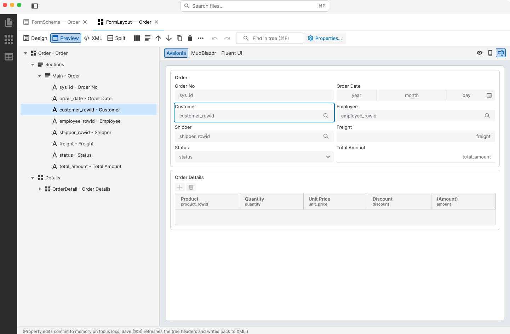
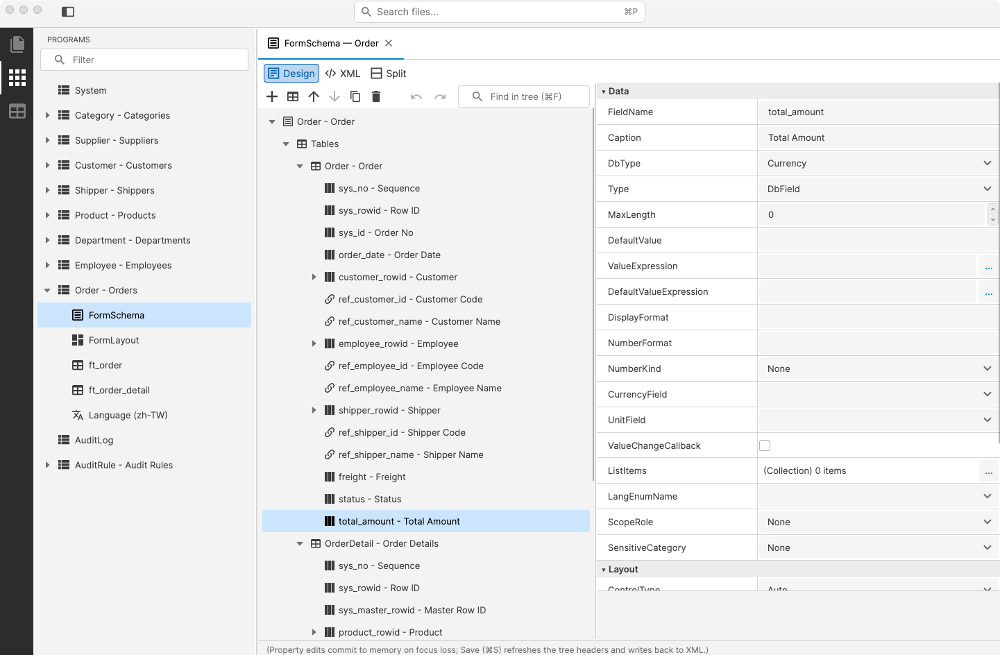
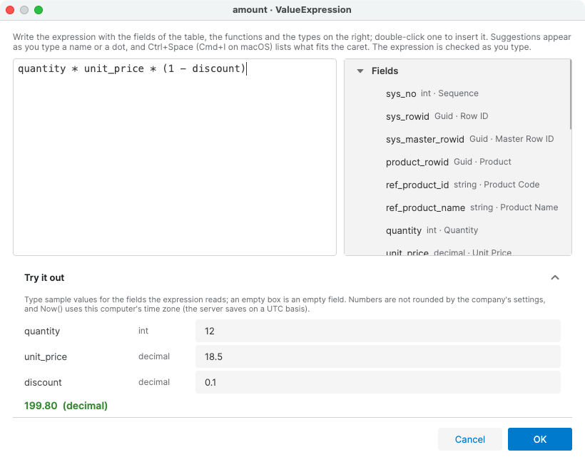
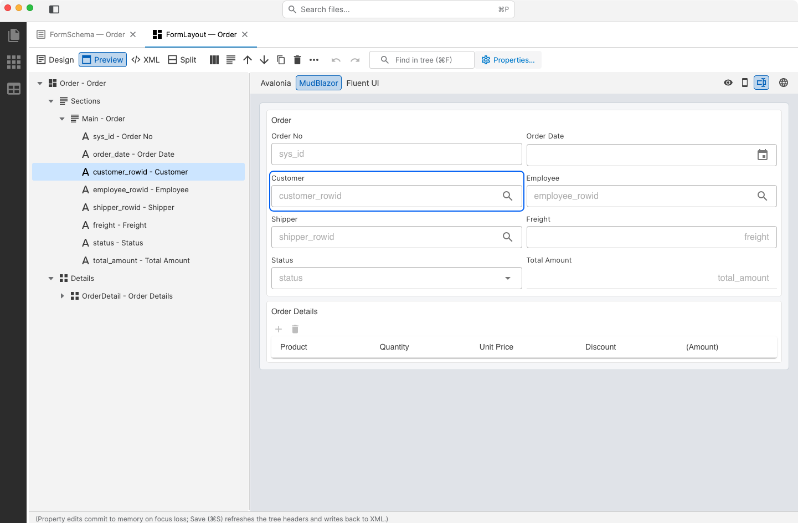
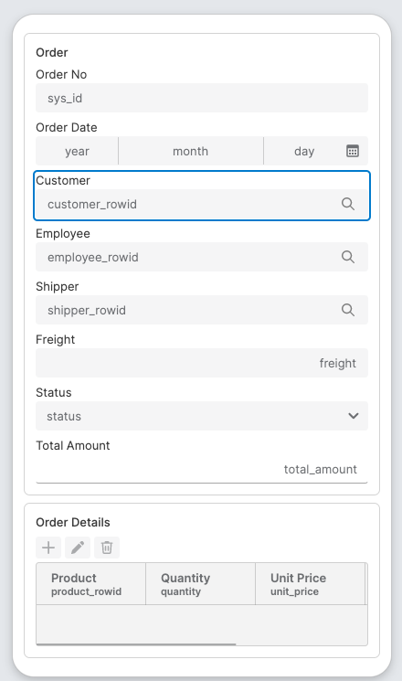
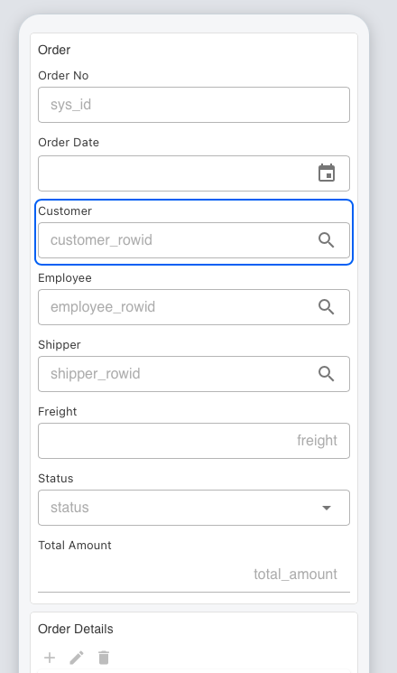
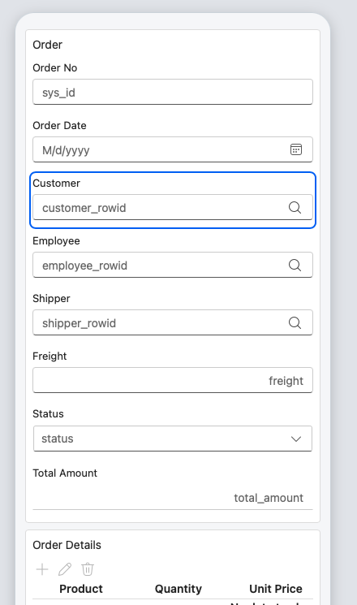
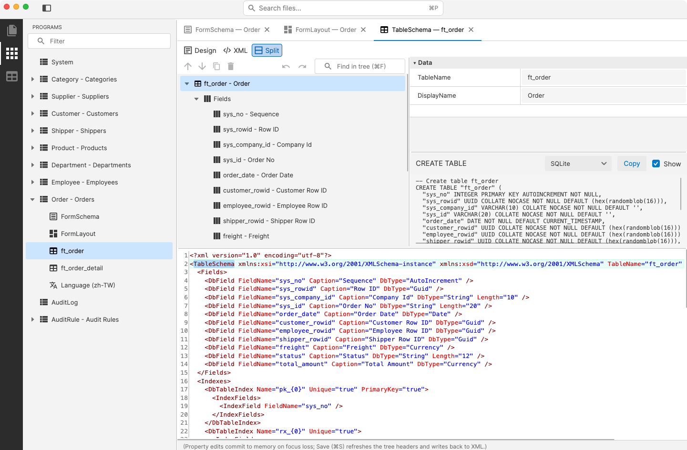

# Polhem.DefineEditor

**English** | [繁體中文](README.zh-TW.md)

A desktop editor for the Polhem definition files, the XML under DefinePath: forms, layouts, table schemas and the
settings files. It runs on Windows, macOS and Linux (Avalonia 12, .NET 10).



- **A development-time tool.** It is published to NuGet as the dotnet tool `Polhem.DefineEditor`, so a project can
  pin it next to its definitions.
- **Offline.** It reads and writes the files under DefinePath and connects to no server. Database work goes through
  the database manager tool (see [Database work](#database-work)).
- **In step with the framework.** It is built on `Polhem.Definition` and every read and write goes through
  `XmlCodec`, so a saved file is exactly what the framework reads.

## Getting started

### Install it in a project

A project pins the editor in its local tool manifest, so everyone who clones the project gets the same version:

```bash
dotnet new tool-manifest            # once per project, when it has no .config/dotnet-tools.json yet
dotnet tool install Polhem.DefineEditor
dotnet polhem-define Define         # opens the project's Define folder
```

After a clone, `dotnet tool restore` installs it again. The package carries the native libraries for macOS, 64-bit
Windows and 64-bit Linux. On macOS a tool runs as a plain executable; when the editor has to be an application (for
example for automation that addresses apps by bundle id), build the `.app` described under
[Building and publishing](#building-and-publishing) and start it with
`open -a Polhem.DefineEditor.app --args <DefinePath>`.

### Run it from source

```bash
dotnet run --project tools/DefineEditor/Polhem.DefineEditor.csproj -- path/to/Define
```

Without a path, choose **Open Folder…** on the welcome page. A relative path is resolved against the current
directory.

Opening a folder only reads it. To seed a new DefinePath with the framework's default definitions (the `st_*` table
schemas, the Department, Employee and AuditRule forms, and the settings files), choose **File → Add Missing Framework
Defaults…**; it lists the files it will write and leaves existing ones alone. The editor saves in place, so copy
`tests/Define/` before exploring it: the tests share those files.

## A tour

### Finding your way

The activity bar on the far left switches the sidebar between three views of the same files (clicking the view
already shown collapses the sidebar):

- **Explorer**: every file under DefinePath, grouped by type.
- **Programs**: each ProgId in `ProgramSettings.xml` with its files: the FormSchema, the FormLayout, the TableSchema
  of each table the form declares, and its Language file in each language.
- **Table Schemas**: each database category in `DbCategorySettings.xml` with its tables. A category is a schema, not
  a connection: in a multi-tenant setup one `company` category stands for every company database.

Three ways to find things:

- **Filter** at the top of the sidebar keeps the nodes whose name or key contains the text.
- **Go to File** (⌘P / Ctrl+P) lists the solution's files by name, key or path; the letters may be apart (`ordfs`
  finds `Order.FormSchema.xml`).
- **Find in tree** (⌘F / Ctrl+F) selects the next node whose label contains the text; Enter and Shift+Enter move
  between matches.

### Editing a definition

Selecting a file opens it in a tab: a tree of the document on the left and a property grid on the right.



- **The property grid** groups the properties by category and describes the selected one underneath. A value that
  differs from its default is in bold, and its context menu resets it.
- **Values that name something** offer what the solution has: a field's `RelationProgId` the programs, a layout
  field's `FieldName` the fields of the form, a FormSchema's `CategoryId` the database categories, and so on. A typed
  value is kept, and validation reports one that names nothing.
- **The toolbar** above the tree holds the selected node's commands: Add, Move Up, Move Down, Duplicate and Delete,
  and the rest behind **⋯**. The node's context menu lists the same commands.
- **Undo and Redo** (⌘Z / Ctrl+Z, ⇧⌘Z / Ctrl+Y) cover property values and node edits, up to the last 100. Delete does
  not ask first, since Undo brings the node back.
- **Validate** in the **File** menu lists the document's problems; each editor also checks its own rules, such as
  duplicate keys.

### FormSchema: relations, expressions and Excel

- **Relations.** The **…** button beside a field's `RelationProgId` opens a dialog: pick the related form, tick the
  fields to carry back, and name each destination (`ref_<base>_<field>` by default). Missing destination fields are
  added to the table.
- **Expressions.** A rule's `When` and `Condition` and a field's `ValueExpression` and `DefaultValueExpression` open
  an expression editor. It lists the table's fields, the helper functions and the types an expression can name,
  completes names as you type, and underlines where parsing stops. **Try it out** evaluates the expression with sample
  values, the way the run time does.

  

  Save and Validate parse every expression of the form with the framework's evaluator, and list the ones that would
  fail at run time.
- **Derived files.** A FormSchema's context menu offers **Generate FormLayout** and **Sync TableSchema and
  FormLayout**, which adds the fields the form gained to its table schemas and layout after showing the files it
  changes.
- **Excel.** **Export to Excel** writes a form as a workbook; **File → Import Form from Excel** and **Import Forms
  from Excel (Batch)** turn workbooks into definition files and can upgrade the database for the new tables. See
  [Modeling Forms in Excel](../../docs/en/guides/excel-form-modeling.md).

### FormLayout: a live preview on desktop, web and phone

The runtime only reads a layout; it is produced and saved here. The **Preview** view of a FormLayout shows the tree
beside a preview that redraws the form as you edit. Clicking a section, field, grid or column in the preview selects
it in the tree, and the node selected in the tree is outlined in the preview. **Properties…** on the toolbar edits the
selected node in a dialog.

The header of the preview chooses how the form is drawn:

- **Avalonia**: with the framework's Avalonia controls, the way a desktop or mobile app shows it (above).
- **MudBlazor** and **Fluent UI**: with the components of `Polhem.Web.Blazor.Mud` or `Polhem.Web.Blazor.Fluent`, the
  way a web app built on that package shows it.



The buttons at the right of the header apply to every engine: **View mode**, **Phone width** and **Field names**
(each field's name in its empty box). Phone width narrows the preview to a phone's:

| Avalonia | MudBlazor | Fluent UI |
|:---:|:---:|:---:|
|  |  |  |

- No preview has data, and none needs a backend.
- The two web previews run in the operating system's web engine (WebView2 on Windows, WKWebView on macOS, WebKitGTK
  on Linux). For the final check in a real browser, the globe button (**Open in browser**) opens the same page in the
  default browser; unsaved edits follow along. The editor serves that page itself on 127.0.0.1, with a random token in
  the address.
- To give the preview more room, hide the side bar (⌘B / Ctrl+B).

### TableSchema and the XML view

**Design / XML / Split** at the top of each editor switches between the tree, the document's XML and both. In Split
the two follow each other: an edit in the tree shows in the XML at once, and typing in the XML reaches the tree after
a pause. A TableSchema also shows the CREATE TABLE statement for SQL Server, PostgreSQL, MySQL, Oracle or SQLite,
produced by the framework's own dialect builders.



- **Typing XML is helped**: `<` lists the elements allowed there, a space in a start tag lists the missing attributes,
  the quotes of an attribute list its values (including the solution's ProgIds and fields), and ⌃Space (⌘I on macOS)
  lists whatever fits the caret.
- **XML that cannot be read** keeps the document as it was: the problems are underlined and listed, and the document
  cannot be saved until they are fixed. An element or attribute the definition does not have counts as a problem,
  since the file would otherwise lose it silently.
- **Comments survive.** A document edited only as XML is saved exactly as typed. A save from the tree keeps each
  comment before the element it stood before.
- **File → Export XML Schemas…** writes an `.xsd` for each kind of definition file, and a `xml.fileAssociations`
  setting for VS Code's XML extension (Red Hat), so other editors can check and complete the files too. Export them
  again after upgrading Polhem.

### Editors by definition type

| Type | What the editor adds |
|------|----------------------|
| **SystemSettings** | A tree of the configuration sections, and free key/value extended properties. Options without a node yet (such as `AuditLogOptions`) are edited in the XML |
| **DatabaseSettings** | Servers and items. A context menu **pastes and parses a connection string** (SQL Server, PostgreSQL, MySQL, Oracle); **Test Connections** at the top |
| **DbCategorySettings** | Categories → tables; checks duplicate ids and table names |
| **ProgramSettings** | The programs with their business object and repository; checks empty or duplicate ProgIds |
| **PermissionModels** | Models → rules, with the framework's own validation |
| **MenuSettings** | Folders → entries |
| **FormSchema** | Tables → fields → relation mappings; relations, expressions, Excel and derived files as above |
| **FormLayout** | Sections → fields, and detail grids → columns; the live preview above |
| **TableSchema** | Fields and indexes; the CREATE TABLE statement for each database |
| **Language** | Items and enums |

### Keys

| Key (macOS / Windows and Linux) | Command |
|---------------------------------|---------|
| ⌘P / Ctrl+P | Go to File |
| ⌘F / Ctrl+F | Find in tree; in the XML, find text |
| ⌘B / Ctrl+B | Show or hide the side bar |
| ⌘Z / Ctrl+Z, ⇧⌘Z / Ctrl+Y | Undo, Redo |
| ⌘S / Ctrl+S | Save |
| ⌫ / Delete | Delete the selected node |
| ⌘D / Ctrl+D | Duplicate it |
| ⌥↑ ⌥↓ / Alt+Up Alt+Down | Move it among its siblings |
| Enter or F2 | Go to the property grid; Esc comes back to the tree |

The **File** and **View** menus are native menus, which Avalonia shows in the macOS menu bar only. On Windows and
Linux the window has its own **File** menu with the same commands except Open Folder and Open Recent. The **View**
menu also switches the theme and the UI language (English / 繁體中文).

## Database work

The editor carries no database driver. Testing the connections, upgrading the tables and previewing an upgrade are done
by the database manager [Polhem.DbManager](../DbManager/README.md) (`polhem-db`), which carries the drivers of every
supported database. The editor runs it through `dotnet tool exec` at exactly its own version, against the open
DefinePath, so nothing has to be installed and no project is needed.

- **Test Connections**, at the top of the DatabaseSettings editor and in the **File** menu, opens a connection to each
  database item.
- **File → Upgrade Database** builds or upgrades every registered table; **Preview Database Upgrade** lists the
  statements without running them. After an import or a sync, the completion dialog upgrades only that form's tables;
  a FormSchema's context menu does the same at any time.
- A window shows the command line and its output as it is written. Closing it or **Cancel** stops the tool. Password
  values in the output are shown as `********`.
- The tool reads the files on disk, so unsaved edits are offered for saving first.

The first run asks before the tool is downloaded, naming the package, the version and the package source; later runs
reuse the copy in the NuGet global packages folder. `dotnet tool exec` needs the .NET SDK. The tool runs in a folder of
the user's own (`Polhem.DefineEditor/dbmanager` in the local application data folder), with nuget.org given on the
command line and the global packages folder pinned, so a `NuGet.Config` or `global.json` in or above the opened folder
cannot choose where the tool comes from or which SDK runs it.

When the editor runs from source, no tool of its version is published yet. Pack one with
`dotnet pack tools/DbManager/Polhem.DbManager.csproj -o <folder>` and name the folder in the `POLHEM_DBMANAGER_SOURCE`
environment variable; the editor passes it as a second package source.

## Building and publishing

A published copy is framework-dependent by default: the target machine needs the .NET 10 runtime and the ASP.NET Core
10 runtime (the browser preview runs in the editor's own process, so without the ASP.NET Core runtime the editor does
not start). A .NET 10 SDK includes both. The two web previews also need the system's web engine: the WebView2 Runtime
on Windows (part of Windows 11) and WebKitGTK 4.1 on Linux (`libwebkit2gtk-4.1-0` on Debian and Ubuntu); macOS has it
built in. Without it only those two previews are unavailable.

[publish.sh](publish.sh) packages osx-arm64, osx-x64, win-x64 and linux-x64, or the RIDs named after its options:

| Command | Output |
|---------|--------|
| `./publish.sh` | Framework-dependent, about 31 MB per RID |
| `./publish.sh --self-contained` | With the .NET runtime, about 100–210 MB per RID |
| `./publish.sh --single-file` | The managed assemblies inside the executable, beside Avalonia's native libraries (which .NET single-file cannot bundle) |
| `./publish.sh --app-bundle osx-arm64` | A `Polhem.DefineEditor.app` for macOS that opens on double-click; implies `--single-file` |

The output is in `tools/DefineEditor/bin/Release/net10.0/<rid>/publish/`. To publish one RID by hand:

```bash
dotnet publish tools/DefineEditor/Polhem.DefineEditor.csproj -c Release \
    -r osx-arm64 --self-contained false -p:PublishTrimmed=false
```

- **Always give a RID.** Without one, Avalonia's native libraries for every platform come along, and the output is
  larger than a self-contained one (measured at 564 MB). The dotnet tool package is the exception: it has to be
  portable, so the project keeps only the desktop runtimes' native libraries (`PolhemKeepDesktopNativeRuntimes`, in
  `tools/Directory.Build.targets`).
- **Trimming stays off.** The definition files are read by `XmlSerializer` through reflection, and trimming strips the
  metadata of nested definition types, so reading fails at run time.
- **Gatekeeper.** An `.app` that is not signed and notarized is blocked the first time it is opened after a download or
  an AirDrop. Right-click it in Finder and choose **Open**, or clear the flag:
  `xattr -d com.apple.quarantine /path/to/Polhem.DefineEditor.app`. An `.app` built on the same machine has no such flag.

### Headless smoke

`--smoke <FormSchema-fixture-path>` runs the editors' round-trips without opening a window. It copies the fixture to a
temporary directory first, prints one line per check, and ends with `[smoke] OK` and exit code 0, or
`[smoke] FAIL(<code>)` and that exit code. The checks are listed in `Smoke.Run` in [`Smoke.cs`](Smoke.cs).

```bash
dotnet run --project tools/DefineEditor/Polhem.DefineEditor.csproj --configuration Debug \
    -- --smoke tests/Define/FormSchema/Employee.FormSchema.xml
```

The editor's unit tests are in `tests/Polhem.DefineEditor.UnitTests`, which is part of `Polhem.slnx`.

## Out of scope

- Connecting to a Polhem server or its JSON-RPC API: the editor works on local files only.
- Several people editing the same files at once, or locking them.
- Customize-layer overrides: the solution tree does not mark them yet.
