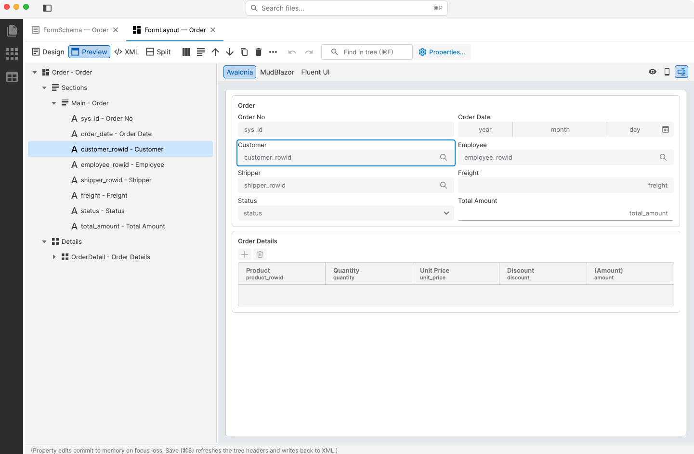
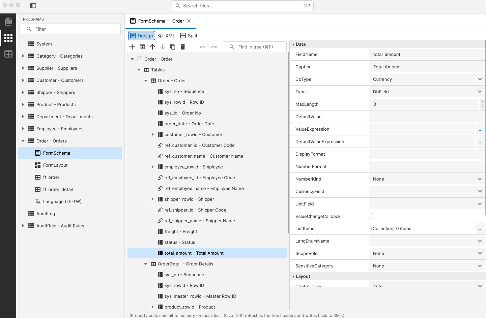
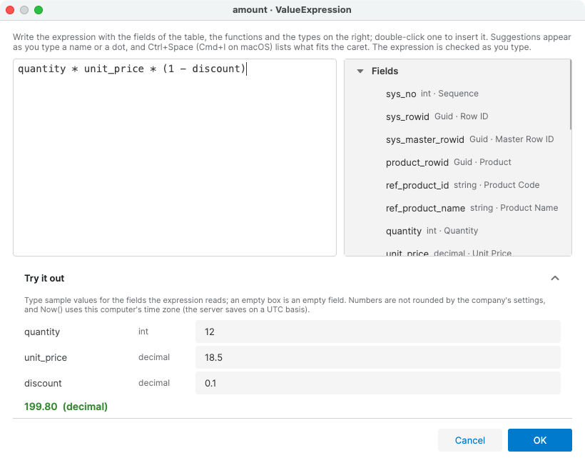
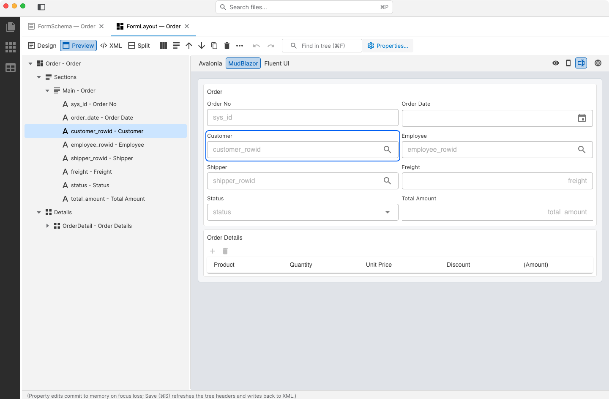
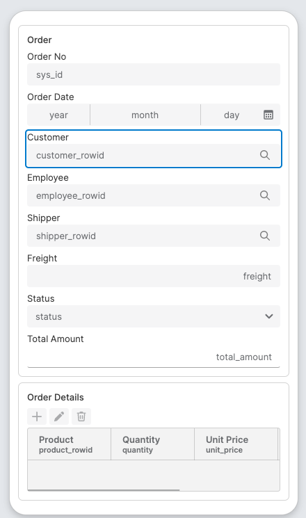
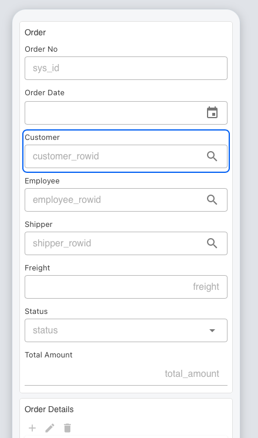
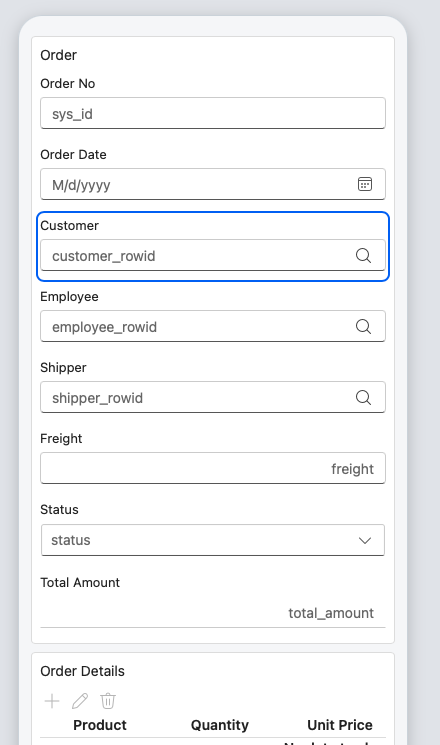
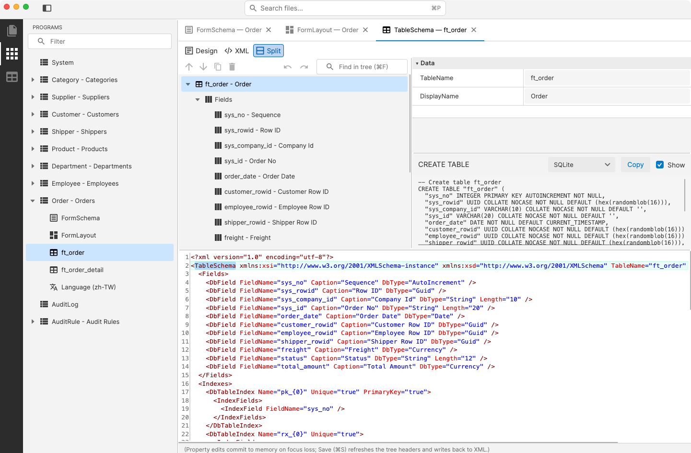

# Polhem.DefineEditor

[English](README.md) | **繁體中文**

Polhem 定義檔（DefinePath 下的 XML）的桌面編輯器：表單、版面、資料表結構與各設定檔。可在 Windows、macOS、Linux 執行
（Avalonia 12、.NET 10）。



- **開發期工具。** 以 dotnet tool `Polhem.DefineEditor` 發佈到 NuGet，專案可以把它和定義檔一起鎖定版本。
- **離線運作。** 直接讀寫 DefinePath 下的檔案，不連任何伺服器。資料庫相關工作交給資料庫管理工具
  （見[資料庫相關工作](#資料庫相關工作)）。
- **與框架同步。** 建立在 `Polhem.Definition` 之上，所有讀寫都經過 `XmlCodec`，存下的檔案就是框架讀取的內容。

## 開始使用

### 安裝到專案

專案把編輯器記在本機工具資訊清單裡，每個 clone 專案的人拿到的都是同一版：

```bash
dotnet new tool-manifest            # 每個專案一次，還沒有 .config/dotnet-tools.json 時
dotnet tool install Polhem.DefineEditor
dotnet polhem-define Define         # 開啟專案的 Define 資料夾
```

clone 之後以 `dotnet tool restore` 重新安裝。套件只帶 macOS、64 位元 Windows 與 64 位元 Linux 的原生程式庫。
在 macOS 上 tool 以一般執行檔執行；需要以應用程式形式執行時（例如以 bundle id 指定 app 的自動化），依
[建置與發佈](#建置與發佈)建出 `.app`，再以 `open -a Polhem.DefineEditor.app --args <DefinePath>` 啟動。

### 從原始碼執行

```bash
dotnet run --project tools/DefineEditor/Polhem.DefineEditor.csproj -- path/to/Define
```

不帶路徑時，在歡迎頁選 **開啟方案**。相對路徑以目前目錄為準。

開啟資料夾只會讀取。要為新的 DefinePath 放入框架的預設定義（`st_*` 資料表結構、Department、Employee 與 AuditRule
表單，以及各設定檔），選 **File → 加入缺少的框架預設檔…**；它會先列出要寫入的檔案，已存在的檔案不動。編輯器直接覆寫原檔，
所以要拿 `tests/Define/` 試用前請先複製一份：測試共用那些檔案。

## 導覽

### 找到要編輯的檔案

最左側的 Activity Bar 切換側欄的三種檢視（再點一次目前檢視的圖示會收合側欄）：

- **檔案總管**：按型別分組列出 DefinePath 下的所有檔案。
- **功能**：`ProgramSettings.xml` 的每個 ProgId 與它的檔案：FormSchema、FormLayout、表單宣告的每個資料表的
  TableSchema，以及各語系的 Language 檔。
- **資料表結構**：`DbCategorySettings.xml` 的每個資料庫分類與其資料表。分類是結構而非連線：多租戶環境下，一個
  `company` 分類代表所有公司資料庫。

三種尋找方式：

- 側欄上方的 **篩選** 只保留名稱或鍵值含有該文字的節點。
- **前往檔案**（⌘P / Ctrl+P）依名稱、鍵值或路徑列出方案的檔案；字母可以不相連（`ordfs` 找得到
  `Order.FormSchema.xml`）。
- **在樹中尋找**（⌘F / Ctrl+F）選取下一個標籤含有該文字的節點；Enter 與 Shift+Enter 在符合項目間移動。

### 編輯定義

點選檔案會在分頁中開啟：左側是文件的樹狀結構，右側是屬性方格。



- **屬性方格** 依分類分組，下方說明所選的屬性。與預設值不同的值以粗體顯示，可用右鍵選單重設。分類與說明跟著介面語言切換；
  屬性名稱維持原文，因為它們就是定義檔的屬性名。
- **指向其他定義的值** 會列出方案裡已有的項目：欄位的 `RelationProgId` 列出功能、版面欄位的 `FieldName` 列出表單的欄位、
  FormSchema 的 `CategoryId` 列出資料庫分類，以此類推。手動輸入的值會保留，指向不存在項目的值由驗證報出。
- **工具列** 在樹狀結構上方，放所選節點的指令：新增、上移、下移、複製、刪除，其餘收在 **⋯** 裡。節點的右鍵選單列出相同的指令。
- **復原與重做**（⌘Z / Ctrl+Z、⇧⌘Z / Ctrl+Y）涵蓋屬性值與節點的編輯，最多 100 步。刪除不先詢問，因為復原就能把節點找回來。
- **File** 選單的 **驗證** 列出文件的問題；各編輯器也會檢查自己的規則，例如重複的鍵值。

### FormSchema：關聯、運算式與 Excel

- **關聯。** 欄位 `RelationProgId` 旁的 **…** 按鈕開啟對話框：選擇關聯表單、勾選要帶回的欄位、指定各自的目的欄位
  （預設為 `ref_<base>_<欄位>`）。本表缺少的目的欄位會自動加入。已存在的目的欄位若型別裝不下來源欄位的值，
  對話框會拒絕套用。對話框編譯的是 analyzer 規則 [POLHEM2008](../../docs/zh-TW/reference/analyzer-rules.md)
  的同一份型別規則，所以它拒絕的型別組合與該規則回報的相同。
- **運算式。** 規則的 `When`、`Condition` 與欄位的 `ValueExpression`、`DefaultValueExpression` 會開啟運算式編輯器。
  旁邊列出本表欄位、輔助函式與運算式可用的型別，輸入時補完名稱，並在解析停下的位置畫底線。**試算** 區以範例值計算運算式，
  算法與執行階段相同。

  

  存檔與驗證時，會以框架的 evaluator 解析表單的每個運算式，列出執行時會失敗的那些。
- **衍生檔。** FormSchema 的右鍵選單有 **產生 FormLayout** 與 **同步 TableSchema 與 FormLayout**；後者先列出要變更的檔案，
  再把表單新增的欄位補進資料表結構與版面。
- **Excel。** **匯出成 Excel** 把表單寫成活頁簿；**File → 從 Excel 匯入表單** 與 **從 Excel 批次匯入表單** 把活頁簿轉成定義檔，
  並可接著為新的資料表升級資料庫。見 [用 Excel 建模表單](../../docs/zh-TW/guides/excel-form-modeling.md)。
- **文件。** **File → 從文件匯入表單** 經你同意後把紙本表單（PDF、Word 或照片）送給 Claude，以對話草擬表單：選取紀錄的欄位會對到
  既有表單、缺的資訊會提問，對話中即時預覽表單畫面。之後按 **產生定義**，以匯入活頁簿的方式匯入。編輯器不保存任何憑證：
  以 `ant auth login` 登入，或設定 `ANTHROPIC_API_KEY`。見
  [從文件草擬表單](../../docs/zh-TW/guides/document-form-drafting.md)。

### FormLayout：桌面、網頁與手機的即時預覽

執行階段只讀版面，版面在這裡產生並存檔。FormLayout 的 **預覽** 檢視在樹狀結構旁顯示預覽，隨編輯即時重畫表單。
在預覽中點區塊、欄位、格線或欄位標題，樹狀結構會選到對應節點；樹上選取的節點也會在預覽中以外框標出。
工具列的 **屬性設定…** 在對話框中編輯所選節點。

預覽標題列選擇表單的繪製方式：

- **Avalonia**：以框架的 Avalonia 控制項繪製，與桌面或行動應用程式的呈現相同（見上圖）。
- **MudBlazor** 與 **Fluent UI**：以 `Polhem.Web.Blazor.Mud` 或 `Polhem.Web.Blazor.Fluent` 的元件繪製，與採用該套件的
  網頁應用程式呈現相同。



標題列右側的按鈕對每種引擎都有效：**檢視模式**、**手機寬度** 與 **欄位名稱**（在空白欄位顯示欄位名稱）。手機寬度把預覽縮到手機的寬度：

| Avalonia | MudBlazor | Fluent UI |
|:---:|:---:|:---:|
|  |  |  |

- 預覽都不帶資料，也不需要後端。
- 兩種網頁預覽在作業系統的網頁引擎中執行（Windows 為 WebView2、macOS 為 WKWebView、Linux 為 WebKitGTK）。要在真正的瀏覽器
  做最終確認，用地球按鈕（**在瀏覽器預覽**）在預設瀏覽器開啟同一個頁面；尚未存檔的修改也會同步。頁面由編輯器自己在
  127.0.0.1 提供，網址帶隨機 token。
- 要讓預覽更寬，可以隱藏側欄（⌘B / Ctrl+B）。

### TableSchema 與 XML 檢視

每個編輯器上方的 **設計 / XML / 分割** 在樹狀結構、文件的 XML 與兩者並列之間切換。分割時兩邊互相跟隨：在樹上的編輯立即反映到
XML，在 XML 中輸入則停頓一下後反映到樹。TableSchema 另外顯示 SQL Server、PostgreSQL、MySQL、Oracle 或 SQLite 的
CREATE TABLE 語法，由框架本身的方言產生器產出。



- **輸入 XML 有提示**：`<` 列出該處允許的元素，起始標籤內按空白列出還沒有的屬性，屬性的引號內列出可用的值（包括方案的
  ProgId 與欄位），⌃Space（macOS 為 ⌘I）列出游標處適用的所有項目。
- **無法讀取的 XML** 不會改動文件：問題處畫底線並列出，修正之前無法存檔。定義沒有的元素或屬性也算問題，否則存檔時會悄悄遺失。
- **註解會保留。** 只以 XML 編輯過的文件會照輸入的內容存檔；從樹狀結構存檔時，每段註解仍留在原本所在的元素之前。
- **File → 匯出 XML 結構描述…** 為每種定義檔寫出 `.xsd`，並附上 VS Code XML 擴充功能（Red Hat）的 `xml.fileAssociations`
  設定，讓其他編輯器也能檢查與補完這些檔案。升級 Polhem 後請重新匯出。

### 各定義型別的編輯器

| 型別 | 編輯器額外提供 |
|------|---------------|
| **SystemSettings** | 各設定區段的樹狀結構，加上自由的鍵值擴充屬性。還沒有節點的選項（例如 `AuditLogOptions`）請直接改 XML |
| **DatabaseSettings** | Server 與 Item。右鍵選單可 **貼上並拆解連線字串**（SQL Server、PostgreSQL、MySQL、Oracle）；上方有 **測試連線** |
| **DbCategorySettings** | 分類 → 資料表；檢查重複的 Id 與資料表名稱 |
| **ProgramSettings** | 各功能及其 Business Object 與 Repository；檢查空白或重複的 ProgId |
| **PermissionModels** | 模型 → 規則，含框架本身的驗證 |
| **MenuSettings** | 資料夾 → 項目 |
| **FormSchema** | 資料表 → 欄位 → 關聯對應；關聯、運算式、Excel 與衍生檔見上文 |
| **FormLayout** | 區塊 → 欄位，以及明細格線 → 欄；即時預覽見上文 |
| **TableSchema** | 欄位與索引；各資料庫的 CREATE TABLE 語法 |
| **Language** | 字串項目與列舉 |

### 快捷鍵

| 按鍵（macOS / Windows 與 Linux） | 指令 |
|---------------------------------|------|
| ⌘P / Ctrl+P | 前往檔案 |
| ⌘F / Ctrl+F | 在樹中尋找；在 XML 中則是尋找文字 |
| ⌘B / Ctrl+B | 顯示或隱藏側欄 |
| ⌘Z / Ctrl+Z、⇧⌘Z / Ctrl+Y | 復原、重做 |
| ⌘S / Ctrl+S | 存檔 |
| ⌫ / Delete | 刪除所選節點 |
| ⌘D / Ctrl+D | 複製所選節點 |
| ⌥↑ ⌥↓ / Alt+Up Alt+Down | 在同層節點間移動 |
| Enter 或 F2 | 移到屬性方格；按 Esc 回到樹狀結構 |

**File** 與 **View** 是原生選單，Avalonia 只在 macOS 的選單列顯示它們。Windows 與 Linux 的視窗有自己的 **File** 選單，
指令相同，但沒有開啟方案與最近開啟。**View** 選單也可切換深淺主題與介面語言（English / 繁體中文）。

## 資料庫相關工作

編輯器不帶資料庫驅動。測試連線、升級資料表與預覽升級，由資料庫管理工具 [Polhem.DbManager](../DbManager/README.zh-TW.md)
（`polhem-db`）負責，它帶有每種支援資料庫的驅動。編輯器以 `dotnet tool exec` 執行與自己完全同版的工具，對象是目前開啟的
DefinePath，所以不需要另外安裝，也不需要專案。

- **測試連線**：在 DatabaseSettings 編輯器上方與 **File** 選單，逐一連線每個資料庫項目。
- **File → 升級資料庫** 建立或升級所有已登記的資料表；**預覽資料庫升級** 只列出語法、不執行。匯入或同步後的完成對話框只升級
  該表單的資料表；FormSchema 的右鍵選單隨時都能做同樣的事。
- 視窗即時顯示命令列與輸出。關閉視窗或按 **取消** 會停止工具。輸出中的密碼值顯示為 `********`。
- 工具讀取的是磁碟上的檔案，所以會先詢問是否儲存尚未存檔的修改。

第一次執行前會先詢問是否下載工具，並列出套件、版本與套件來源；之後重用 NuGet 全域套件資料夾中的那一份。
`dotnet tool exec` 需要 .NET SDK。工具在使用者自己的資料夾（本機應用程式資料夾下的 `Polhem.DefineEditor/dbmanager`）中執行，
命令列指定 nuget.org 為來源並固定全域套件資料夾，所以開啟的資料夾內或其上層的 `NuGet.Config`、`global.json` 無法決定工具的
來源或執行它的 SDK。

從原始碼執行編輯器時，同版的工具還沒有發佈。以 `dotnet pack tools/DbManager/Polhem.DbManager.csproj -o <資料夾>` 打包一份，
再把該資料夾設為環境變數 `POLHEM_DBMANAGER_SOURCE`；編輯器會把它當作第二個套件來源。

## 建置與發佈

發佈的版本預設為 framework-dependent：目標電腦需要先裝 .NET 10 runtime 與 ASP.NET Core 10 runtime（瀏覽器預覽在編輯器
自己的程序中執行，缺少 ASP.NET Core runtime 時編輯器無法啟動）。.NET 10 SDK 兩者都有。兩種網頁預覽另外需要系統的網頁引擎：
Windows 為 WebView2 Runtime（Windows 11 內建），Linux 為 WebKitGTK 4.1（Debian 與 Ubuntu 為 `libwebkit2gtk-4.1-0`）；
macOS 內建。缺少時只有這兩種預覽無法使用。

[publish.sh](publish.sh) 打包 osx-arm64、osx-x64、win-x64 與 linux-x64，或選項後指定的 RID：

| 指令 | 產出 |
|------|------|
| `./publish.sh` | framework-dependent，每個 RID 約 31 MB |
| `./publish.sh --self-contained` | 內含 .NET runtime，每個 RID 約 100–210 MB |
| `./publish.sh --single-file` | managed 組件包進執行檔，旁邊是 Avalonia 的原生程式庫（.NET single-file 無法打包原生程式庫） |
| `./publish.sh --app-bundle osx-arm64` | 可雙擊開啟的 macOS `Polhem.DefineEditor.app`；隱含 `--single-file` |

產出在 `tools/DefineEditor/bin/Release/net10.0/<rid>/publish/`。手動發佈單一 RID：

```bash
dotnet publish tools/DefineEditor/Polhem.DefineEditor.csproj -c Release \
    -r osx-arm64 --self-contained false -p:PublishTrimmed=false
```

- **一定要指定 RID。** 不指定時，Avalonia 各平台的原生程式庫都會帶進來，結果比 self-contained 還大（實測 564 MB）。
  dotnet tool 套件是例外：它必須可攜，所以專案只保留桌面平台的原生程式庫（`PolhemKeepDesktopNativeRuntimes`，在
  `tools/Directory.Build.targets`）。
- **不開 trimming。** 定義檔由 `XmlSerializer` 以反射讀取，trimming 會移除巢狀定義型別的中繼資料，執行時讀檔失敗。
- **Gatekeeper。** 沒有簽章與公證的 `.app`，下載或 AirDrop 後第一次開啟會被擋下。在 Finder 對它按右鍵選 **打開**，或清除旗標：
  `xattr -d com.apple.quarantine /path/to/Polhem.DefineEditor.app`。在同一台電腦建出的 `.app` 沒有這個旗標。

### Headless smoke

`--smoke <FormSchema 測試檔路徑>` 不開視窗執行各編輯器的 round-trip。它先把測試檔複製到暫存目錄，每項檢查印一行，全部通過時以
`[smoke] OK` 結尾並回傳 0，否則印出 `[smoke] FAIL(<code>)` 並以該代碼結束。檢查項目以 [`Smoke.cs`](Smoke.cs) 的 `Smoke.Run`
為準。

```bash
dotnet run --project tools/DefineEditor/Polhem.DefineEditor.csproj --configuration Debug \
    -- --smoke tests/Define/FormSchema/Employee.FormSchema.xml
```

編輯器的單元測試在 `tests/Polhem.DefineEditor.UnitTests`，屬於 `Polhem.slnx`。

## 不在工具範圍

- 連線到 Polhem 伺服器或其 JSON-RPC API：編輯器只處理本機檔案。
- 多人同時編輯同一份檔案，或鎖定檔案。
- Customize 層的覆寫：方案樹還不會標示它們。
